<p align="center">
  
</p>

<h1 align="center">Pulsimo</h1>

<p align="center">
  <b>Self-hosted monitoring for your endpoints, metrics, logs and incidents.</b><br>
  One Docker Compose project on your own server. Your data stays with you.
</p>

<p align="center">
  
  
  
  
</p>

<p align="center">
  <a href="https://pulsimo.github.io">Website</a> ·
  <a href="release-docs-beta/README.md">Documentation</a> ·
  <a href="#install">Install</a> ·
  <a href="release-docs-beta/release-notes.md">Release notes</a> ·
  <a href="https://docs.google.com/forms/d/e/1FAIpQLSc3ZuyIwqytCaw7NNatE79mkhB6DzbwMYq29fEIRC17bfO8vA/viewform">Report a bug</a>
</p>

<p align="center">
  <picture><source media="(prefers-color-scheme: dark)" srcset="release-docs-beta/images/screenshots/dark/overview.png"><source media="(prefers-color-scheme: light)" srcset="release-docs-beta/images/screenshots/light/overview.png">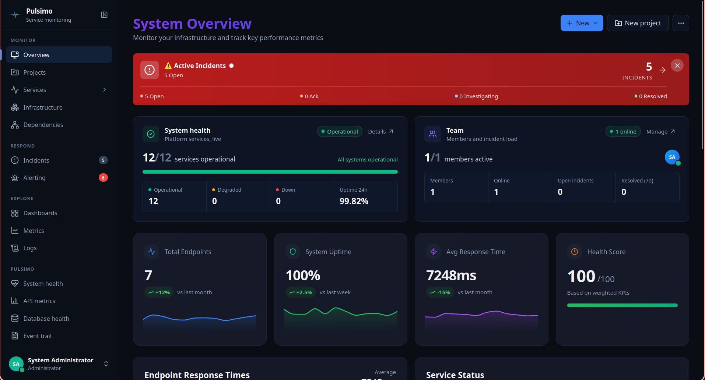</picture>
</p>

## What is Pulsimo?

Pulsimo checks your websites, APIs, databases and other services, pulls their metrics and
logs, opens incidents with the evidence attached, and tells the right people. Everything
runs on your own server: checks, metrics, logs and users stay in Pulsimo's own databases,
and alerts go only to the channels you set up.

- **Endpoint checks.** HTTP and HTTPS (with methods, headers, auth and GraphQL), PostgreSQL,
  MySQL, Redis, Elasticsearch, gRPC and WebSocket, every 10 seconds to every hour. Each check
  records DNS, connect, TLS, first byte and transfer, and every HTTPS certificate is watched.
- **Metrics and dashboards.** Point Pulsimo at any Prometheus `/metrics` and it scrapes on a
  schedule. Graph with PromQL or a point-and-click builder, build Grafana-style dashboards or
  import Grafana JSON, and judge a service from its own 5xx rate, p95 and traffic.
- **Logs.** Ship logs with Fluent Bit or a shipper you already run, search them in the Log
  Browser, and let new exceptions open incidents that resolve themselves.
- **Infrastructure.** Hosts and containers from node_exporter and cAdvisor, and Kubernetes
  clusters from kube-state-metrics, with alarms built in.
- **Incidents and reliability.** Incidents carry the evidence and the impact, with ranked
  probable causes. SLOs with error budgets and burn-rate alerts, deploy markers on every
  chart, capacity forecasts and anomaly detection.
- **Alerting.** Rules for checks, metrics, logs and traffic; delivery to Slack, Discord,
  Microsoft Teams, Google Chat, email and webhooks; routing, digests, deploy grace and
  maintenance windows.
- **Administration.** Roles, API keys, an event trail of who did what, and pages that show
  Pulsimo's own health, storage and retention.

## Screenshots

Screenshots follow your GitHub theme: switch between light and dark to see both.

<table>
<tr><td width="50%" valign="top"><picture><source media="(prefers-color-scheme: dark)" srcset="release-docs-beta/images/screenshots/dark/services.png"><source media="(prefers-color-scheme: light)" srcset="release-docs-beta/images/screenshots/light/services.png">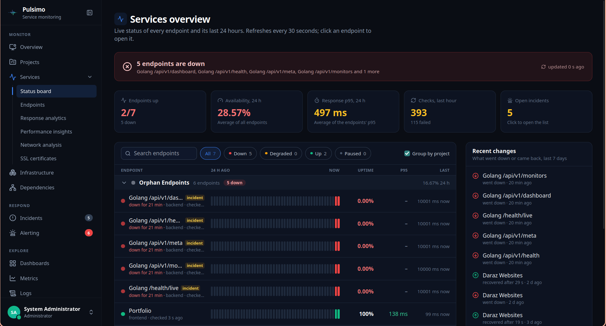</picture><br><b>Status board</b><br><sub>Every service live, grouped by project, with recent changes.</sub></td><td width="50%" valign="top"><picture><source media="(prefers-color-scheme: dark)" srcset="release-docs-beta/images/screenshots/dark/endpoints.png"><source media="(prefers-color-scheme: light)" srcset="release-docs-beta/images/screenshots/light/endpoints.png">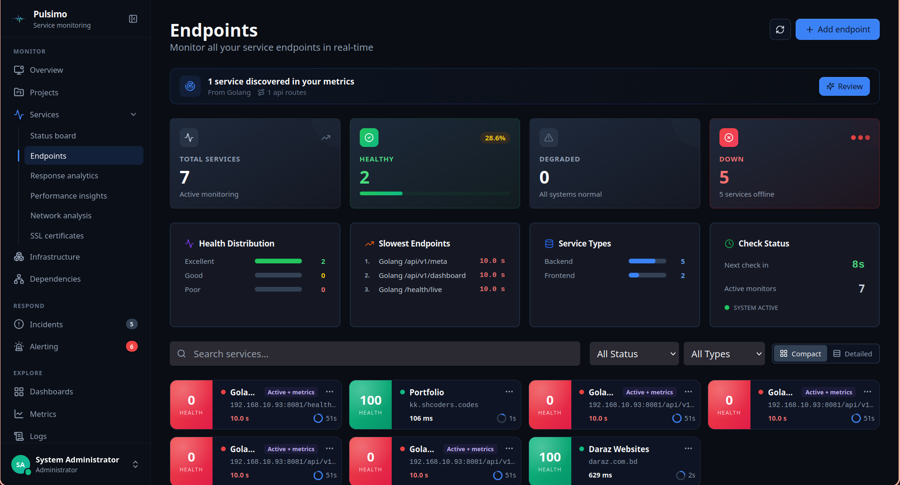</picture><br><b>Endpoints</b><br><sub>Health, slowest endpoints and service types, with discovered services to add.</sub></td></tr>
<tr><td width="50%" valign="top"><picture><source media="(prefers-color-scheme: dark)" srcset="release-docs-beta/images/screenshots/dark/projects.png"><source media="(prefers-color-scheme: light)" srcset="release-docs-beta/images/screenshots/light/projects.png">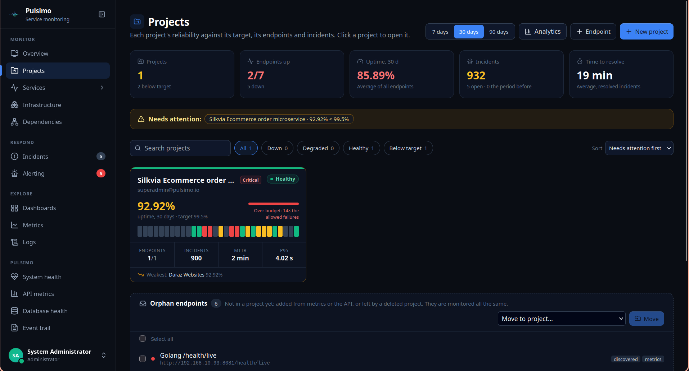</picture><br><b>Projects</b><br><sub>Reliability against targets, error budgets and who needs attention.</sub></td><td width="50%" valign="top"><picture><source media="(prefers-color-scheme: dark)" srcset="release-docs-beta/images/screenshots/dark/service-dashboard.png"><source media="(prefers-color-scheme: light)" srcset="release-docs-beta/images/screenshots/light/service-dashboard.png">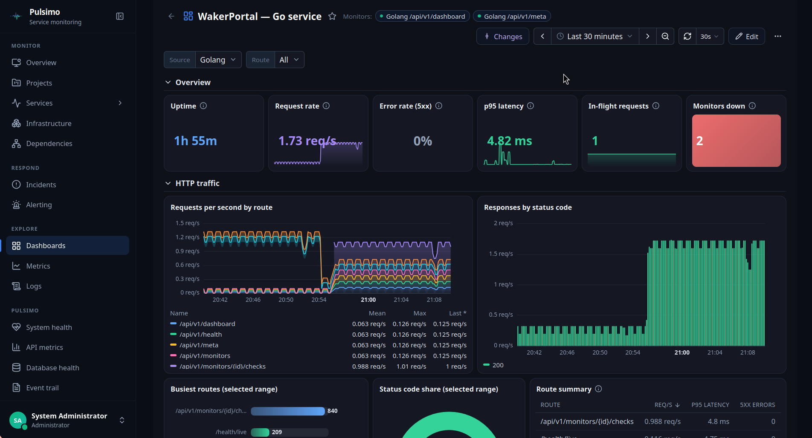</picture><br><b>Service dashboard</b><br><sub>A service's own metrics: request rate, error rate, latency and routes.</sub></td></tr>
<tr><td width="50%" valign="top"><picture><source media="(prefers-color-scheme: dark)" srcset="release-docs-beta/images/screenshots/dark/response-analytics.png"><source media="(prefers-color-scheme: light)" srcset="release-docs-beta/images/screenshots/light/response-analytics.png">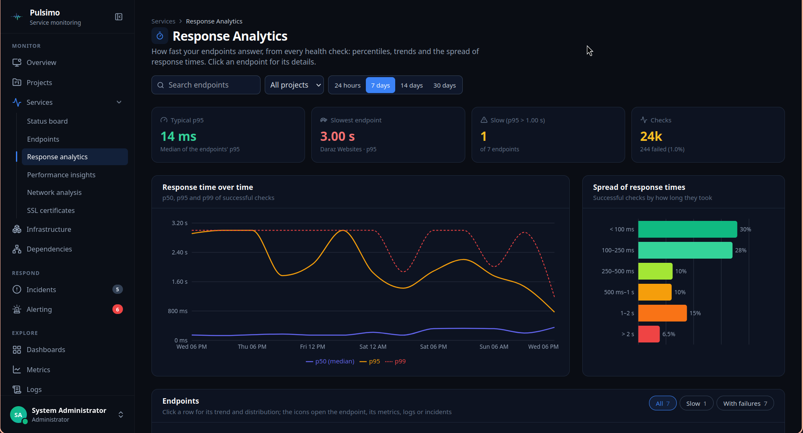</picture><br><b>Response analytics</b><br><sub>Percentiles, spread and network phases for every check.</sub></td><td width="50%" valign="top">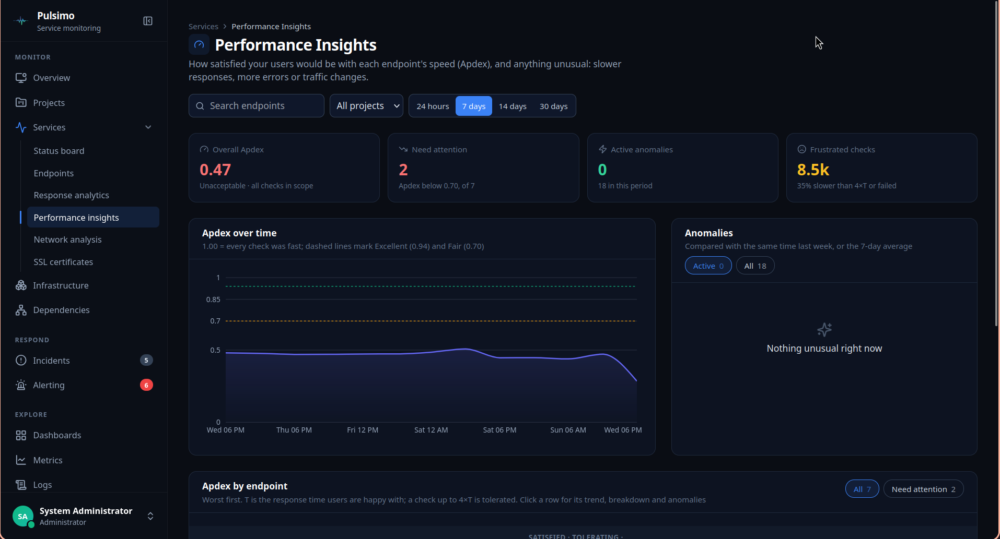<br><b>Performance insights</b><br><sub>Apdex, anomalies and the endpoints that need attention.</sub></td></tr>
<tr><td width="50%" valign="top"><picture><source media="(prefers-color-scheme: dark)" srcset="release-docs-beta/images/screenshots/dark/alerting.png"><source media="(prefers-color-scheme: light)" srcset="release-docs-beta/images/screenshots/light/alerting.png">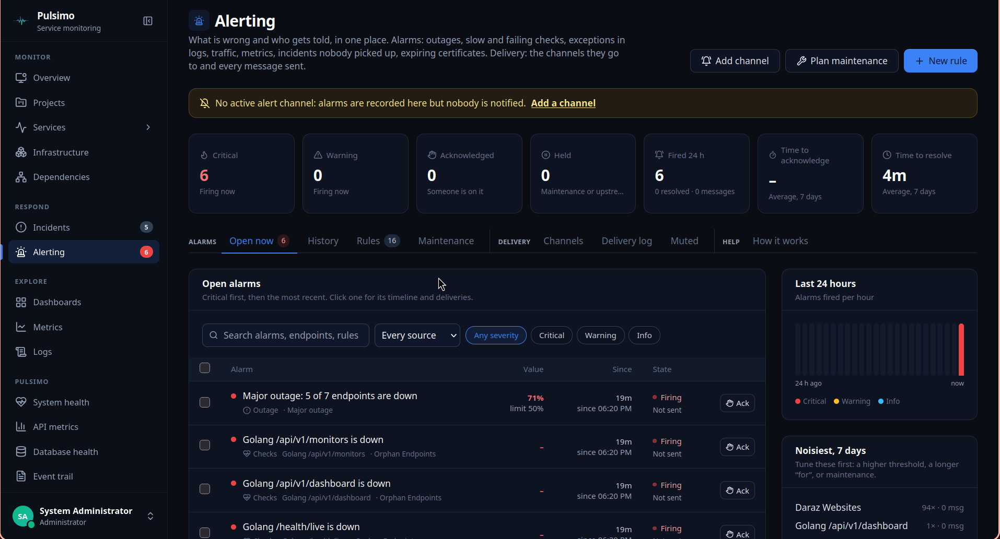</picture><br><b>Alerting</b><br><sub>Open alarms, rules, channels, maintenance windows and the delivery log.</sub></td><td width="50%" valign="top">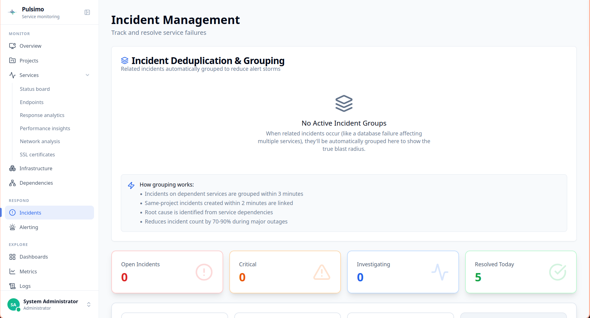<br><b>Incidents</b><br><sub>Related failures grouped into one incident, with root cause and impact.</sub></td></tr>
<tr><td width="50%" valign="top"><picture><source media="(prefers-color-scheme: dark)" srcset="release-docs-beta/images/screenshots/dark/logs.png"><source media="(prefers-color-scheme: light)" srcset="release-docs-beta/images/screenshots/light/logs.png">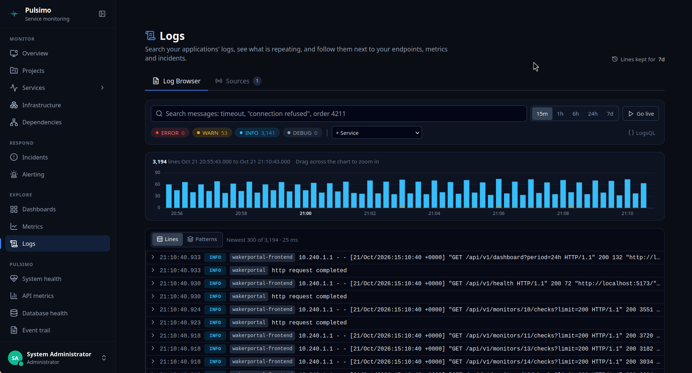</picture><br><b>Logs</b><br><sub>Search application logs, see what repeats and link them to endpoints.</sub></td><td width="50%" valign="top"><picture><source media="(prefers-color-scheme: dark)" srcset="release-docs-beta/images/screenshots/dark/infrastructure.png"><source media="(prefers-color-scheme: light)" srcset="release-docs-beta/images/screenshots/light/infrastructure.png">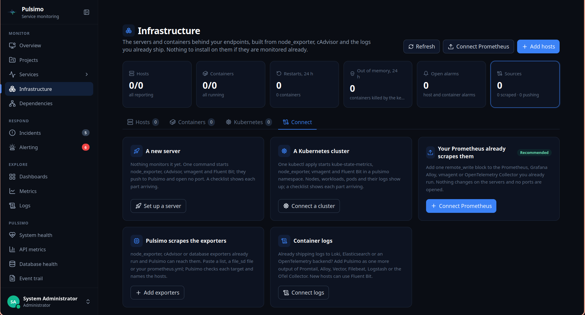</picture><br><b>Infrastructure</b><br><sub>Hosts, containers and Kubernetes from the exporters you already run.</sub></td></tr>
<tr><td width="50%" valign="top">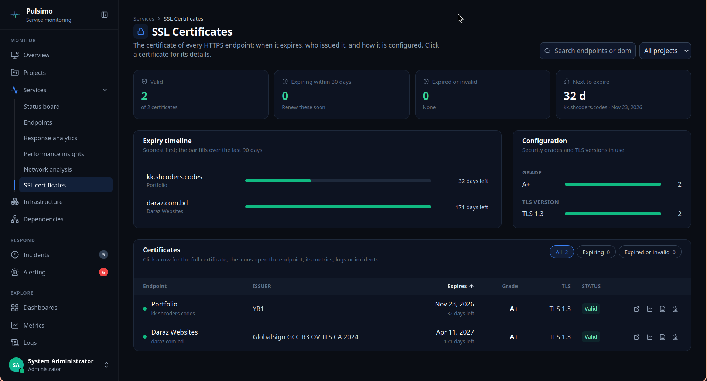<br><b>SSL certificates</b><br><sub>Expiry timeline, issuer, grade and TLS version for every HTTPS endpoint.</sub></td></tr>
</table>

## Install

You need a Linux server with Docker 20.10+ and Docker Compose v2, 4 vCPU and 8 GB of memory.

```bash
git clone https://github.com/Cloud-Council/pulsimo.git
cd pulsimo
chmod +x setup.sh
./setup.sh
```

The script detects the server's address, writes `.env` with a generated database password,
JWT secret and metrics key, pulls the images and starts everything.

Prefer to do it by hand?

```bash
cp .env.example .env
# set HOST_IP, POSTGRES_PASSWORD, JWT_SECRET and METRICS_SECRET_KEY in .env
docker compose -f docker-compose.yml pull
docker compose -f docker-compose.yml up -d
```

Then open `http://<HOST_IP>:3000` and sign in as `superadmin@pulsimo.io` with the password
`admin`. Change that password straight away (**Users** → your row → **Change password**).
Self sign-up is turned off in this release; add your team from **Users**. The [Installation guide](release-docs-beta/installation/README.md)
covers every step, and the [Quick start](release-docs-beta/getting-started.md) takes you to
your first endpoint and alert channel.

### What's in this repository

| File | What it is |
|---|---|
| `docker-compose.yml` | Every Pulsimo service, from published `pulsimo/*` images |
| `.env.example` | The configuration template; copy it to `.env` |
| `setup.sh` | Guided install: checks Docker, writes `.env`, starts everything |
| `release-docs-beta/` | The documentation |

Each image has its own version tag, set as the default in `docker-compose.yml` (for example
`pulsimo/pulsimo_be_api_gateway:rc1beta-v0.1.9`). To upgrade, pull the new
`docker-compose.yml` and run `pull` and `up -d` again; database migrations run on start. To
pin or roll back one image, set its variable in `.env`, e.g. `API_GATEWAY_VERSION=rc1beta-v0.1.8`.

## Documentation

The full documentation is in [release-docs-beta](release-docs-beta/README.md) and on the
[website](https://pulsimo.github.io/docs/).

### Get started

- [Installation](release-docs-beta/installation/README.md): Run Pulsimo on your own server with Docker Compose and the published images.
- [Quick start](release-docs-beta/getting-started.md): From an empty install to your first endpoint, alert channel and metric source in about ten minutes.
- [Your first project](release-docs-beta/first-project.md): Group endpoints into a project, set a reliability target and see it on the status board.
- [Architecture](release-docs-beta/architecture.md): The services that make up Pulsimo, where data lives and how a check becomes an alert.
- [Configuration](release-docs-beta/configuration/environment-variables.md): Every .env value: what it controls, which service reads it, defaults, ranges and recipes.

### Services and checks

- [Projects and overview](release-docs-beta/features/projects.md): The live status board, project reliability against targets and error budgets, and project analytics.
- [Endpoints and checks](release-docs-beta/features/health-checks.md): What Pulsimo can check, every endpoint setting, and how a check decides Up, Degraded or Down.
- [Monitoring from metrics](release-docs-beta/features/metric-monitors.md): Health from the app's own metrics (5xx, p95, traffic) instead of, or as well as, calling it.
- [Service analytics](release-docs-beta/features/service-performance.md): Response times, Apdex and anomalies, network phases and certificates for every endpoint.
- [Dependencies](release-docs-beta/features/dependencies.md): A live map of which service needs which, suggestions with evidence, and impact on incidents.

### Metrics and dashboards

- [Metric sources](release-docs-beta/features/metrics/sources.md): Tell Pulsimo where /metrics lives and it pulls on a schedule.
- [Metrics Explorer](release-docs-beta/features/metrics/explorer.md): Graph anything with PromQL or a point-and-click builder.
- [Dashboards](release-docs-beta/features/dashboard.md): Grafana-style dashboards with an editor, variables and Grafana JSON import.
- [Connected monitoring](release-docs-beta/features/metrics/connected-monitoring.md): One service, one place: endpoint checks, its metrics and its dashboards together.
- [Discovered services](release-docs-beta/features/metrics/discovery.md): APIs, databases, hosts and containers found in your metrics, ready to monitor.

### Logs

- [Logs](release-docs-beta/features/logs/README.md): Collect app logs with Fluent Bit, search them in the Log Browser and link them to endpoints.
- [Logs end to end](release-docs-beta/features/logs/walkthrough.md): Walkthrough: a Docker host's logs from Fluent Bit to endpoints and incidents.
- [Incidents from logs](release-docs-beta/features/logs/incidents-from-logs.md): Exceptions in the logs open incidents that resolve themselves. Tune, test on 24 hours, mute.

### Infrastructure

- [Hosts and containers](release-docs-beta/features/infrastructure/README.md): Servers and containers from node_exporter, cAdvisor and their logs, with built-in alarms.
- [Kubernetes](release-docs-beta/features/infrastructure/kubernetes.md): Clusters, nodes, workloads and pods from kube-state-metrics, with the agent in one kubectl apply.

### Incidents and reliability

- [Incidents and evidence](release-docs-beta/features/incidents.md): What the metrics showed, saved with the incident, and impact computed for you.
- [Probable cause](release-docs-beta/features/probable-cause.md): Ranked causes from changes, logs and metrics. Confirm, resolve, and see what happened before.
- [SLOs](release-docs-beta/features/reliability/slos.md): Error budgets, burn-rate alerts and real-user Apdex.
- [Change markers](release-docs-beta/features/reliability/change-markers.md): Deploys, restarts and new routes drawn on every chart.
- [Capacity and anomalies](release-docs-beta/features/reliability/capacity-and-anomalies.md): "Disk full in about 3 days" and "traffic 70% below last week".

### Alerting

- [Alarms and rules](release-docs-beta/features/alarms.md): Rules for logs, traffic, metrics, incidents and checks; acknowledging, routing and maintenance windows.
- [Channels and delivery](release-docs-beta/features/alerts.md): Slack, Discord, Teams, Google Chat, email and webhooks, with tests, a delivery log and muting.
- [Routing, digests and deploy grace](release-docs-beta/features/alert-routing.md): The right channel, fewer pages during deploys, and one digest for the small stuff.

### Administration

- [Users and access](release-docs-beta/features/users.md): Roles, who needs attention, safe administration, and access that changes at once.
- [Settings and API keys](release-docs-beta/features/settings.md): Organization, sign-in security, API keys, integrations and configuration backup.
- [API metrics and Event trail](release-docs-beta/features/observability/api-metrics.md): How Pulsimo's API answers per route, and who did what, with filters and export.

### Pulsimo's own health

- [System and database health](release-docs-beta/features/observability/system-health.md): Every Pulsimo component probed with real uptime; storage, retention and maintenance jobs.
- [Monitoring pipeline](release-docs-beta/features/observability/pipeline-health.md): Check lag, scrape success, alert delay and series per source.

### API

- [Authentication](release-docs-beta/api/authentication.md): Sign in with an API key or a session token, scopes, and error responses.
- [API reference](release-docs-beta/api/README.md): Every REST endpoint, grouped by feature.
- [Webhooks](release-docs-beta/api/webhooks.md): The JSON Pulsimo sends to webhook channels, and how to handle it.

### Guides

- [Running in production](release-docs-beta/production.md): Secrets, HTTPS, firewall, backups, retention and upgrades.
- [Best practices](release-docs-beta/best-practices.md): How to set up checks, alerts and projects so the right people hear about the right things.
- [Troubleshooting](release-docs-beta/troubleshooting.md): Fixes for sign-in, checks, email, logs and metrics problems.
- [FAQ](release-docs-beta/faq.md): Short answers to common questions.
- [Release notes](release-docs-beta/release-notes.md): What changed in recent releases.

## Status and support

Pulsimo is in **public beta** and free to use during the beta. Pricing will be announced
before the official launch. Test it well before you rely on it for production alerting.

- Questions: [support@pulsimo.dev](mailto:support@pulsimo.dev) or the [contact page](https://pulsimo.github.io/contact/)
- Bugs: the [bug report form](https://docs.google.com/forms/d/e/1FAIpQLSc3ZuyIwqytCaw7NNatE79mkhB6DzbwMYq29fEIRC17bfO8vA/viewform)
- Answers to common questions: the [FAQ](release-docs-beta/faq.md) and [Troubleshooting](release-docs-beta/troubleshooting.md)

## License

Pulsimo is proprietary software. Using it requires agreeing to the
[Pulsimo Proprietary Software License Agreement](LICENSE); see also [NOTICE](NOTICE).
